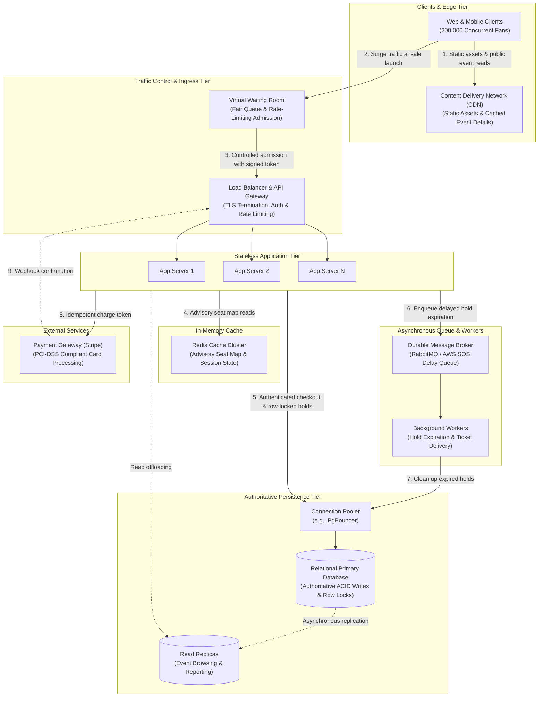

# TicketHub System Design

## 1. Requirements

### Functional requirements

- Visitors can browse and search events and view event details, venue sections, prices, and seat availability.
- A signed-in user can temporarily hold one or more available seats, complete payment before the hold expires, and view their purchased tickets.
- A hold expires automatically if checkout is not completed; its seats become available again.
- The system sends a clear result when seats are unavailable or a payment fails. It must not issue more tickets than there are seats.
- Support 2 million registered users, 50,000 daily visitors, and 5,000 tickets sold on a normal day. A popular sale has 200,000 people trying to buy 20,000 seats in its first 10 minutes.

### Non-functional requirements

- **Correctness:** A seat can have at most one active holder or one completed sale. Payment and ticket issuance must be idempotent so retries do not create duplicate charges or tickets.
- **Speed:** Event and seat-map reads should feel responsive under normal use. During a sale, give each buyer a prompt queue or availability result; do not make the database serve an uncontrolled burst.
- **Fairness:** Publish the queue and sale policy, apply it consistently, and prevent clients from bypassing the queue to call seat-hold operations directly. Limit automated abuse without allowing retries to jump ahead.
- **Availability and durability:** Keep browsing available during a sale and persist completed orders and payment outcomes. If the write path is overloaded, queue or reject requests clearly rather than showing misleading availability.
- **Security:** Require authentication for holds, payments, and ticket access; validate all inputs; use a trusted payment provider and do not store card numbers.

---

## 2. Traffic estimates

Assumptions: daily averages are spread across 24 hours; each page view is one page/API read for this estimate. These averages do not include normal rush-hour peaks or retries.

### Normal day

- Page views: 50,000 visitors × 10 pages = **500,000 page views/day**.
- Average page-view rate: 500,000 ÷ 86,400 = **about 5.8 page views/second**.
- Ticket sales: 5,000 ÷ 86,400 = **about 0.058 tickets/second**, or one ticket every 17 seconds on average.

### Popular concert sale

- Buyer attempts: 200,000 ÷ 600 seconds = **about 333 people/second on average** for 10 minutes.
- If each person loads the event page, views the seat map, and submits one hold request, that is roughly **1,000 API requests/second** across those three actions, before retries, polling, payment, and any sharper-than-average bursts.
- At one seat per buyer, only 20,000 of the 200,000 attempts can succeed: **at most 10%**. The 20,000 seats represent an average of **33 successful seat sales/second** if sold evenly over the full 10 minutes; demand will not arrive evenly.
- The 333 event-page loads/second alone are about **58 times** the normal all-site average page-view rate. The 333 hold attempts/second are about **5,760 times** the normal average ticket-sale rate. These compare different measures and are useful as rough scale indicators, not direct capacity guarantees.

The virtual waiting room must absorb and pace this burst so only admitted buyers reach the seat-hold write path at a rate the database connection pool can safely handle.

---

## 3. API

All endpoints are under `/api`. Authenticated endpoints require a user session. Use an idempotency key for hold and payment submissions; return clear `4xx` errors for invalid, expired, or unavailable requests and `429 Too Many Requests` when throttled.

| Method and path | Purpose | Typical response |
|---|---|---|
| `GET /events?query=&date=&cursor=` | Browse/search published events, with pagination. | `200 OK` with event summaries and next cursor. |
| `GET /events/{eventId}` | Read event details, venue, sale status, and pricing information. | `200 OK`, or `404 Not Found`. |
| `GET /events/{eventId}/seats` | Read a seat map and current availability. Availability is advisory; a seat is not reserved until a hold succeeds. | `200 OK` with sections and seat statuses. |
| `POST /events/{eventId}/holds` | Hold selected seats for the authenticated user. Request includes `seatIds` and an idempotency key. | `201 Created` with `holdId`, held seats, and `expiresAt`; `409 Conflict` if any requested seat is no longer available. |
| `POST /orders/{orderId}/payment` | Pay for an active held order. Request includes a payment method token from the payment provider and an idempotency key. | `200 OK` with payment/order status; a declined payment does not mark seats sold. |
| `GET /me/tickets` | List the user's confirmed tickets and event/seat details. | `200 OK` with ticket records. |

---

## 4. Data model

Use a relational database as the authoritative source for seat ownership and order state. IDs below are primary keys; foreign keys enforce the stated relationships.

- **`users`**: `id`, `email UNIQUE`, `password_hash`, `created_at`. One user can own many orders.
- **`events`**: `id`, `name`, `venue`, `starts_at`, `sale_opens_at`, `status`. One event has many seats and orders.
- **`seats`**: `id`, `event_id FK -> events.id`, `section`, `seat_label`, `price`, `status` (`available`, `held`, `sold`), nullable `current_order_id FK -> orders.id`, nullable `hold_expires_at`. Add `UNIQUE (event_id, seat_label)` so a physical seat is represented only once for an event.
- **`orders`**: `id`, `user_id FK -> users.id`, `event_id FK -> events.id`, `status` (`holding`, `pending_payment`, `paid`, `expired`, `cancelled`), `created_at`, `expires_at`, `idempotency_key`. Add `UNIQUE (user_id, idempotency_key)` so a retried request cannot create a second order.
- **`order_items`**: `id`, `order_id FK -> orders.id`, `seat_id FK -> seats.id`, `price_at_purchase`. Add `UNIQUE (order_id, seat_id)` to prevent duplicate lines in one order. This records order contents; `seats.current_order_id` is the authoritative current assignment.
- **`payments`**: `id`, `order_id FK -> orders.id`, `provider_reference UNIQUE`, `status`, `amount`, `created_at`. One order can have payment attempts, identified idempotently with the provider; never store raw card details.

Relationships: `users 1:N orders`, `events 1:N seats`, `events 1:N orders`, `orders 1:N order_items`, `seats 1:N order_items` over their purchase history, and `orders 1:N payments`. A seat's nullable `current_order_id` points to at most one current order; it is cleared when a hold expires or is cancelled and retained for the paid order after sale.

---

## 5. Preventing double-booking and managing concurrency

Under extreme concurrency—such as 200,000 buyers targeting 20,000 seats in 10 minutes—multiple requests will attempt to hold the exact same high-demand seats within milliseconds of each other. The seat record in the primary relational database is the sole authoritative source of truth. Advisory caches or seat maps may be slightly stale, so the database write transaction must enforce atomic serialization, row-level locking, and state validation.

### Transaction isolation level

The system uses **`READ COMMITTED`** isolation paired with explicit **pessimistic row-level locking (`SELECT ... FOR UPDATE`)**:

- **Why `READ COMMITTED` instead of `SERIALIZABLE`:** While `SERIALIZABLE` provides the highest theoretical safety, in high-contention relational engines (like PostgreSQL or MySQL InnoDB), it relies on optimistic read-write conflict detection (SSI). When hundreds of buyers contend for the same seat rows simultaneously, `SERIALIZABLE` causes massive transaction abort storms (`40001 serialization_failure`). The resulting application retries overwhelm the database CPU and connection pool.
- **Why `READ COMMITTED` + `FOR UPDATE`:** Under `READ COMMITTED`, explicit `SELECT ... FOR UPDATE` row locks queue competing transactions on the specific rows. Once the active holder's transaction commits or rolls back, waiting transactions wake up, re-read the freshly committed row state, and immediately detect that the seat is no longer available. This guarantees 100% double-booking prevention without transaction abort storms.

### Exact SQL transaction for holding seats

When a user requests to hold seats (e.g., seats 101 and 102 for 10 minutes), the application executes the following transactional workflow:

```sql
-- Step 0: Begin transaction with READ COMMITTED isolation
BEGIN TRANSACTION ISOLATION LEVEL READ COMMITTED;

-- Step 1: Lock the target seat rows in deterministic ascending ID order.
-- Sorting by ID is mandatory to eliminate deadlocks across multi-seat requests.
SELECT id, status, hold_expires_at, current_order_id, price
FROM seats
WHERE id IN (101, 102)
ORDER BY id ASC
FOR UPDATE;

-- Step 2: Application-layer status validation:
-- Verify that:
--   a) Exactly 2 rows were returned (all requested seats exist).
--   b) For every returned seat, EITHER:
--        status = 'available'
--      OR:
--        (status = 'held' AND hold_expires_at < NOW())
-- If any seat has status = 'sold', or status = 'held' with hold_expires_at >= NOW(),
-- the application issues ROLLBACK and returns HTTP 409 Conflict:
-- ROLLBACK;

-- Step 3: If any seat had an expired hold, mark its previous order as expired
UPDATE orders
SET status = 'expired'
WHERE id IN (
    SELECT current_order_id
    FROM seats
    WHERE id IN (101, 102)
      AND status = 'held'
      AND hold_expires_at < NOW()
      AND current_order_id IS NOT NULL
);

-- Step 4: Insert the new order with the client's idempotency key
INSERT INTO orders (
    id, user_id, event_id, status, created_at, expires_at, idempotency_key
) VALUES (
    'ord_849204',
    'usr_10293',
    'evt_501',
    'holding',
    NOW(),
    NOW() + INTERVAL '10 minutes',
    'idem_hold_a1b2c3d4'
);

-- Step 5: Insert order line items (UNIQUE constraint prevents duplicate seats in order)
INSERT INTO order_items (order_id, seat_id, price_at_purchase)
VALUES
    ('ord_849204', 101, 75.00),
    ('ord_849204', 102, 75.00);

-- Step 6: Atomically transition the seats to held and assign the order
UPDATE seats
SET status = 'held',
    current_order_id = 'ord_849204',
    hold_expires_at = NOW() + INTERVAL '10 minutes'
WHERE id IN (101, 102);

-- Step 7: Commit the transaction, releasing the row locks
COMMIT;
```

### Row locking mechanism and deadlock prevention

1. **Deadlock elimination via deterministic lock ordering:** If Buyer A attempts to hold seats `[101, 102]` while Buyer B attempts to hold `[102, 101]`, locking them in random order would cause a classic circular deadlock (Buyer A locks 101 waiting on 102; Buyer B locks 102 waiting on 101). By enforcing `ORDER BY id ASC` across all queries, transactions always acquire locks in identical sequential order, rendering deadlocks impossible.
2. **Alternative non-blocking locking (`FOR UPDATE NOWAIT`):** For fast-fail scenarios, `SELECT ... FOR UPDATE NOWAIT` can be used. If another transaction holds the lock, the database immediately returns an error rather than waiting, allowing the application to return `409 Conflict` instantaneously.
3. **Simultaneous hold attempt timeline (User A vs. User B):**
   - **T1:** User A and User B concurrently submit hold requests for seat 101.
   - **T2:** User A's transaction reaches the database first; `SELECT ... FOR UPDATE` acquires the row lock on seat 101.
   - **T3:** User B's `SELECT ... FOR UPDATE` attempts to lock seat 101; the database pauses User B's transaction, waiting for User A's lock to release.
   - **T4:** User A validates seat 101 is `available`, creates the order, updates seat 101 to `held`, and issues `COMMIT`.
   - **T5:** User A's locks release. User B's transaction wakes up and reads the committed row: `status = 'held'` and `hold_expires_at` is in the future.
   - **T6:** User B's application code detects the seat is unavailable, issues `ROLLBACK`, and returns `409 Conflict` ("Seat no longer available"). Double-booking is strictly prevented.

### Payment confirmation transaction

When payment succeeds with the external payment gateway, the order and seats are finalized atomically. Calling the external payment gateway is **never** done inside an open database transaction. Instead, the application makes an idempotent payment call, receives the payment token, and then runs the database update:

```sql
BEGIN TRANSACTION ISOLATION LEVEL READ COMMITTED;

-- Lock and verify the order is still in 'holding' state and not expired
SELECT id, status, expires_at
FROM orders
WHERE id = 'ord_849204'
FOR UPDATE;

-- Application validation:
-- If status != 'holding' OR expires_at < NOW(), the hold expired before payment.
-- The application triggers ROLLBACK, followed by an immediate payment refund/void API call.

-- Lock the associated seats
SELECT id, status, current_order_id
FROM seats
WHERE current_order_id = 'ord_849204'
ORDER BY id ASC
FOR UPDATE;

-- Update order status to paid
UPDATE orders
SET status = 'paid'
WHERE id = 'ord_849204';

-- Finalize seats to sold
UPDATE seats
SET status = 'sold',
    hold_expires_at = NULL
WHERE current_order_id = 'ord_849204';

-- Record payment audit record idempotently
INSERT INTO payments (
    id, order_id, provider_reference, status, amount, created_at
) VALUES (
    'pay_9921',
    'ord_849204',
    'ch_stripe_3M19aBc',
    'succeeded',
    150.00,
    NOW()
);

COMMIT;
```

### Queue architecture for hold expiration

To ensure abandoned holds are promptly released without costly database polling scans, the system uses an asynchronous message queue with delayed delivery (e.g., RabbitMQ Dead Letter Exchange or AWS SQS with message delay):

1. **Scheduling expiration:** When order `ord_849204` is created, the application publishes a message `{"orderId": "ord_849204"}` to the queue with a 10-minute delay (`TTL = 600s`).
2. **Worker execution:** Upon expiration, a background worker consumes the message and executes an idempotent, conditional cleanup transaction:
   ```sql
   BEGIN TRANSACTION ISOLATION LEVEL READ COMMITTED;

   -- Transition order to expired only if it is still in holding status
   UPDATE orders
   SET status = 'expired'
   WHERE id = 'ord_849204'
     AND status = 'holding'
     AND expires_at <= NOW();

   -- Release seats only if the order was genuinely expired (never if it was paid!)
   UPDATE seats
   SET status = 'available',
       current_order_id = NULL,
       hold_expires_at = NULL
   WHERE current_order_id = 'ord_849204'
     AND status = 'held';

   COMMIT;
   ```
3. **Handling the late-payment race condition:** If a payment confirmation arrives after the hold has expired and the seat was reassigned to another buyer, the payment transaction fails validation. Because we cannot issue a ticket for an already sold seat, the system automatically calls the payment provider's API to void or refund the charge, recording the outcome and alerting the user.

---

## 6. Architecture



```text
 [Web / mobile clients]
          │
          ├── static assets and cached public event data ──> [CDN]
          │
          ▼
 [Virtual waiting room] (absorbs 200,000 concurrent fans; issues signed admission tokens)
          │
          ▼
 [Load balancer / API gateway] (TLS termination, auth validation, rate limiting)
          │
          ▼
 [Stateless application servers (N instances)] ─────> [Redis cache cluster]
          │                                              (advisory seat availability & sessions)
          ├── authoritative writes & holds ──> [Connection pooler (PgBouncer)]
          │                                              │
          │                                              ▼
          │                                    [Relational primary DB]
          │                                              │
          │                                              └──> [Read replicas]
          │
          ├── payment processing ──> [Payment provider (Stripe)]
          │
          └── delayed tasks / events ──> [Durable queue (SQS/RabbitMQ)] ──> [Workers]
                                                                            (expiration, tickets)
```

### How the architecture protects the database from surge overload

When 200,000 users arrive at the start of a sale, sending raw requests directly to the database would exhaust connections, overwhelm CPU/IOPS, and crash the service. The system protects the primary database through multi-tiered buffering:

1. **Edge caching (CDN):** Serves all static UI assets, images, and public event descriptions. The CDN handles over 90% of overall HTTP request volume, ensuring browsing traffic never touches origin servers.
2. **Virtual waiting room (traffic pacing gatekeeper):** Incoming sale traffic is intercepted by a virtual waiting room (e.g., Cloudflare Waiting Room or an edge token-bucket queue). When traffic exceeds safe thresholds, users are held in a fair, first-in-first-out queue with a live wait time estimate. The waiting room meters admission, releasing only 50–100 buyers/second with cryptographically signed admission cookies. This ensures the database write load remains strictly within its tested capacity.
3. **Load balancer / API gateway:** Validates the waiting room signature tokens, rejects forged requests, terminates TLS, enforces per-IP rate limits, and load balances admitted traffic across stateless application instances.
4. **Advisory cache (Redis):** Caches the event seat map. When seats are held, Redis is updated asynchronously or evicted. Read requests for seat maps (`GET /events/{id}/seats`) read from Redis, shielding the database from repeated polling by users inspecting availability.
5. **Connection pooler (PgBouncer):** Sits directly in front of the relational primary. It pools database connections, multiplexing hundreds of application threads into a fixed, safe pool of database connections (e.g., 50–100 active connections), completely preventing PostgreSQL connection exhaustion.
6. **Relational primary database:** Serves exclusively as the serialized, transactional authority for row-locked seat holds and payment updates. Because the waiting room throttles inbound writes and Redis/replicas absorb reads, the primary processes clean, low-latency transactions without lock contention spikes.
7. **Durable queue and background workers:** Asynchronous tasks (hold expiration, order confirmation emails, PDF ticket generation) are published to a durable message queue. Background workers process these tasks out-of-band, keeping the interactive checkout API path fast and lightweight.

---

## 7. System trade-offs

- **Pessimistic row locking (`FOR UPDATE`) vs. optimistic concurrency control (OCC):** 
  - *Trade-off:* OCC (`UPDATE seats SET status='held' WHERE id=:id AND status='available'`) requires no database lock holding, which works well under low contention. However, during a 200,000-user sale on 20,000 seats, OCC causes massive collision rates, forcing clients to retry repeatedly and creating severe write amplification. Pessimistic row locking serializes competing requests cleanly at the row level, allowing the first buyer to claim the seat while immediately rejecting competitors without retry churn. The trade-off is that transactions hold locks for a few milliseconds, making transaction brevity essential.
- **Virtual waiting room pacing vs. immediate buyer access:**
  - *Trade-off:* An admission queue introduces artificial latency and requires users to wait in line. However, unthrottled access would crash the primary database, resulting in total system downtime for all users. Metering access via a waiting room trades immediate entry for deterministic system stability, predictable checkout latencies, and guaranteed transactional correctness.
- **Advisory caching vs. real-time seat freshness:**
  - *Trade-off:* Caching seat maps in Redis allows tens of thousands of users to view venue layouts without querying the database, but cached data can lag behind actual database state by a few seconds. A buyer might click a seat that was held a moment prior. We resolve this by explicitly documenting that seat-map availability is advisory; true reservation is guaranteed only upon receiving a successful `201 Created` response from the transactional hold endpoint.
- **Timed holds (10 minutes) vs. inventory lockup:**
  - *Trade-off:* A 10-minute hold window gives genuine buyers ample time to enter payment details and complete multi-factor authentication (3D Secure). However, if buyers abandon their carts, inventory remains locked and unavailable to other fans for 10 minutes. We mitigate this by sending automated reminder prompts, allowing users to explicitly release holds, and using background expiration queues to restore abandoned seats immediately.
- **Late payment handling vs. overselling:**
  - *Trade-off:* If a payment gateway webhook arrives after the 10-minute hold has expired and the seat has been reclaimed, the system refuses to issue a duplicate ticket. Instead, it issues an immediate automatic void or refund. While this causes minor friction for the buyer whose payment was delayed, it preserves the absolute invariant that physical seating inventory can never be oversold.
